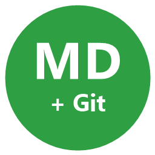

# Markdown and Git Homework

Aquest projecte serveix per practicar Git i Markdown. Pots consultar la [Git Documentation](https://git-scm.com/doc) per aprendre més sobre Git.

## Table of Contents

- [Introduction](#introduction)
- [Features](#features)
- [Installation](#installation)
- [Usage](#usage)
- [License](#license)

## Introduction

Aquest repositori conté els exercicis de la pràctica Pt2.1, on s'aprèn a treballar amb Git i a donar format a documents amb Markdown.

## Features

Llista de les funcionalitats del projecte.

| Feature | Description | Status |
|---------|-------------|--------|
| Table of Contents | Índex amb enllaços interns a cada secció del README | Completed |
| Project Logo | Logotip del projecte inserit amb sintaxi Markdown | Completed |
| Contribution Guidelines | Fitxer CONTRIBUTING.md amb les normes per contribuir | In Progress |
| GitHub Integration | Repositori remot a GitHub amb issues i pull requests | Planned |

## Installation

Clona el repositori al teu ordinador:

    git clone https://github.com/usuari/MarkdownProject.git

## Usage

Obre el fitxer `README.md` amb VSCode i utilitza la previsualització Markdown per veure el resultat.

## License

Aquest projecte està sota la llicència MIT.
